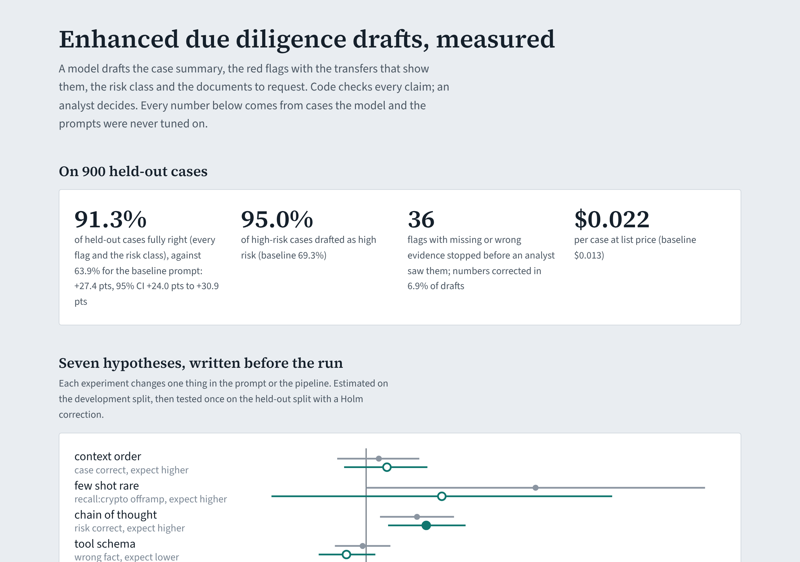
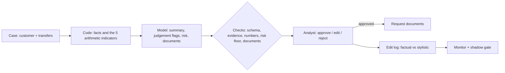

# edd-case-intelligence

[](https://github.com/manojrevenkar12-web/edd-case-intelligence/actions/workflows/ci.yml)

**An enhanced due diligence (EDD) case workbench for a payments company's AML team, built to be measured.**

For each case a model drafts four things:
- a case summary;
- the red flags, each with the transfers that show it;
- a risk class;
- the documents to request.

Code checks every claim before an analyst sees it, and the analyst decides.

Around the drafts sits the work that makes them trustworthy:
- **Labels:** a labelling taxonomy and a golden set labelled by two SMEs and adjudicated by a senior reviewer.
- **Evaluation:** an eval harness with intervals and failure modes, and pre-registered prompt experiments tested
  once on a held-out split.
- **Production:** shadow mode, drift and edit-rate monitoring, and a LangGraph workflow that contacts a customer
  only after an analyst approves.
- **Upstream:** a first-week model that stops some future cases before they reach the operations team.



## Results at a glance

On 900 held-out cases the configuration was never tuned on (pinned in `config/heldout.lock`, run once):

| | Baseline prompt | Chosen configuration |
|---|---|---|
| **Cases fully right** (every flag and the risk class) | 63.9% | **91.3%** (95% CI 89.3–93.0%) |
| High-risk cases drafted as high risk | 69.3% | **95.0%** |
| Flag precision / recall | 0.937 / 0.727 | 0.975 / 0.945 |
| Risk class accuracy | 75.9% | 95.8% |
| Cost per case at list price, p95 latency | $0.013, 3.1 s | $0.022, 12.2 s |

- **Lift:** +27.4 points of fully right cases (paired bootstrap 95% CI +24.0 to +30.9).
- **The checks:**
  - 36 flags with missing or wrong evidence were stopped before an analyst saw them. Without the checks, 5.4% of
    drafts would have shown such a flag.
  - Numbers were corrected in 6.9% of drafts.
  - Flag precision rises from 0.934 to 0.975.
- **The checks' cost:** a little recall (0.952 to 0.945), when a true flag came with invented evidence.

| Area | What is here | Measured |
|---|---|---|
| **Taxonomy and labels** | Seven red flags with definitions, severities, evidence rules and documents; a risk rule with mitigations ([taxonomy.yaml](config/taxonomy.yaml), [guideline](docs/labelling-guideline.md)). Two SMEs label, Cohen's kappa per flag, a senior reviewer adjudicates ([agreement.py](src/edd/agreement.py)) | 121 disagreements on 900 held-out cases. Risk kappa 0.91. "Profile mismatch" is the open definition (kappa 0.73) |
| **Draft pipeline** | One structured call per case. Context built from the taxonomy; strict schema with one retry. Each check: evidence must exist and show the pattern; numbers must match the transfers; computed indicators added; a risk floor without a verified business; documents per flag ([pipeline.py](src/edd/pipeline.py), [features.py](src/edd/features.py)) | 0.2% of held-out cases without a usable draft |
| **Eval harness** | Per-flag precision and recall, risk class, high-risk recall and case-level accuracy, all with Wilson intervals. Failure-mode counts. Paired bootstrap comparisons ([evals.py](src/edd/evals.py)) | Failure modes by count: wrong number, missed flag, unsupported evidence |
| **Prompt experiments** | Seven hypotheses written before any run ([registry.yaml](experiments/registry.yaml)): context order, few-shot, chain of thought, tool schema, computed indicators, a smaller model, more examples. Development estimates, then one held-out test with Holm ([experiments.py](src/edd/experiments.py)) | **2 of 7 confirmed:** computed indicators +23.0 pts, chain of thought +5.8 pts of risk accuracy. Context order and more examples were not |
| **Production loop** | Analysts' edits split into factual and stylistic ([edits.py](src/edd/edits.py)). A p-chart on the factual-edit rate, PSI on case features, flag-rate tests ([monitor.py](src/edd/monitor.py)). A shadow gate: non-inferior on high-risk cases and better overall ([shadow.py](src/edd/shadow.py)) | A new mule typology arrives in week 7 and the alert fires that week, with 0 false alerts before it. The shadowed candidate is promoted in week 10; the factual-edit rate goes from 19.3% back to 8.7% |
| **Deflection** | LightGBM on first-week features, judged as a policy: future high-risk cases caught per share of good customers asked for documents ([deflection.py](src/edd/deflection.py)) | AUC 0.88 vs 0.57 for first-week rules. At 2% friction, 33% of future high-risk cases are caught (rules 20%); at 5%, 48% (rules 20%) |
| **Human in the loop** | LangGraph workflow: draft, analyst review as an interrupt with a checkpoint, then the document request, only with the documents the analyst approved ([workflow.py](src/edd/workflow.py)) | Tested: no contact before approval, none after a rejection |
| **Service** | FastAPI endpoints for drafts and reviews. Claude through the Anthropic API with a forced tool schema and prompt caching ([api.py](src/edd/api.py), [claude.py](src/edd/claude.py)). Docker | 25 Python tests, 4 dashboard tests |

## How a case flows



## What the measurements say

- **Arithmetic belongs in code.**
  - Five of the seven flags are sums and time windows. Computing them and asking the model only for the two
    judgement flags (profile mismatch, crypto exchanges) was the largest gain by far.
  - It agrees with Wise's own write-up ("Scaling Fincrime Operations"): start simple, use rigid schemas and
    deterministic guardrails.
- **Chain of thought helps the risk class, at a price.** It brought +5.8 points of risk accuracy, at four times
  the p95 latency, which is acceptable for a draft read later.
- **Most promising-looking changes did not hold.**
  - Few-shot examples for a rare typology looked like +16 points on the development split.
  - On the held-out split the interval spans zero, so it was not adopted.
- **The edit rate is the earliest honest signal.**
  - When a typology the examples never showed arrives, the factual-edit rate rises above its control limit the
    same week, before any label pipeline would notice.
  - Stylistic edits are excluded, so analysts' wording preferences do not raise false alarms.

## Limits

- **Simulated model.** The foundation model is simulated: how often it finds a flag, invents evidence or a number,
  or ignores a mitigating context depends on the configuration in hidden ways. Experiment effects measure that
  simulation, not Claude. The Claude adapter is tested against a fake client; nothing here called a live API.
- **Synthetic people and cases.** Cases, SMEs, analysts and the customer population are synthetic. The taxonomy is
  a reasonable sketch of EDD practice, not Wise's.
- **Small deflection test set.** The deflection test set has 138 future high-risk cases, so its curve is coarse.

## Run it

```bash
pip install -e ".[dev]"
make test && make dev && make report
cd web && npm ci && npm run dev
```

`AGENTS.md` has the invariants and the held-out rule.
